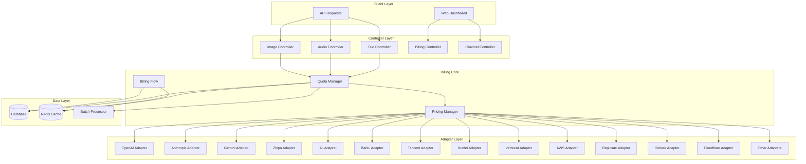
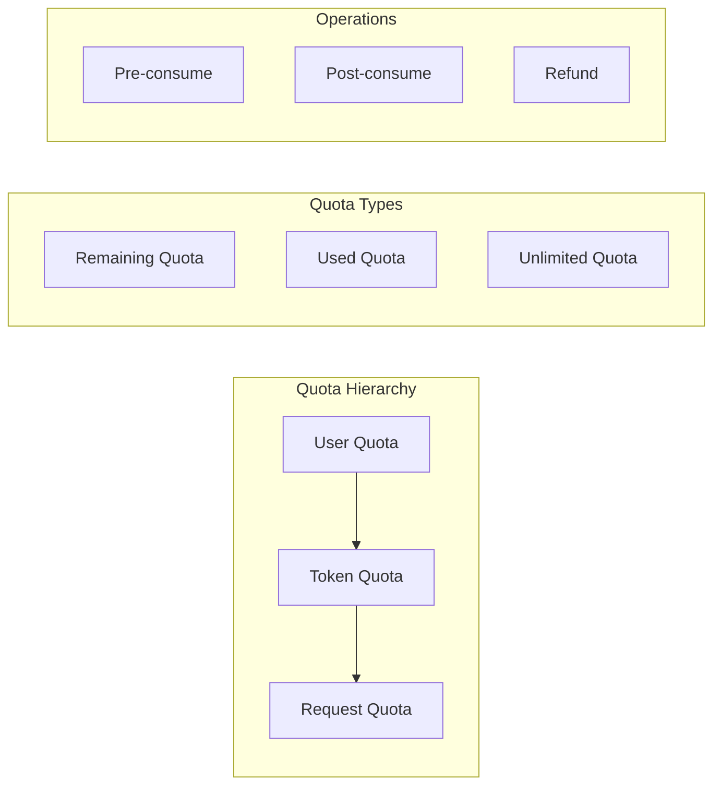
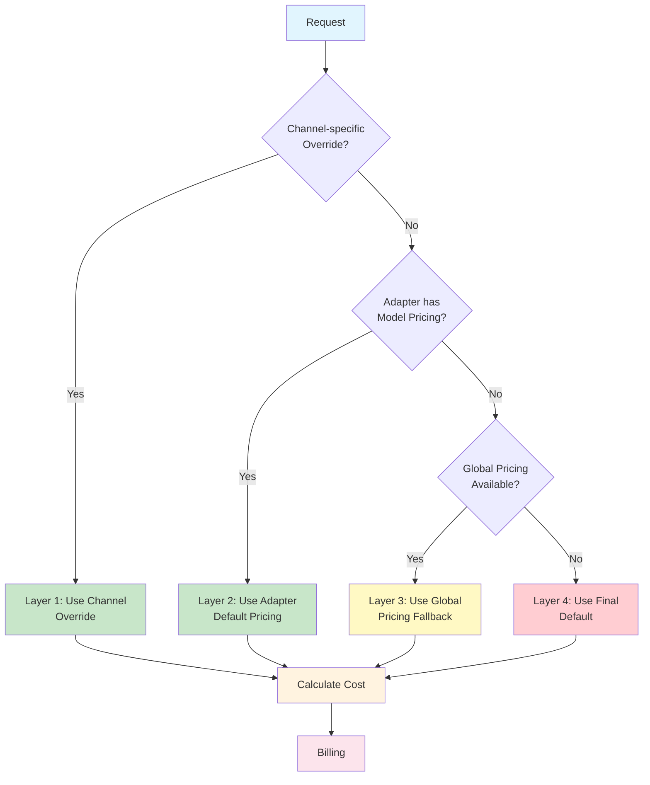
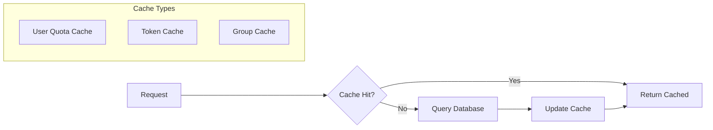
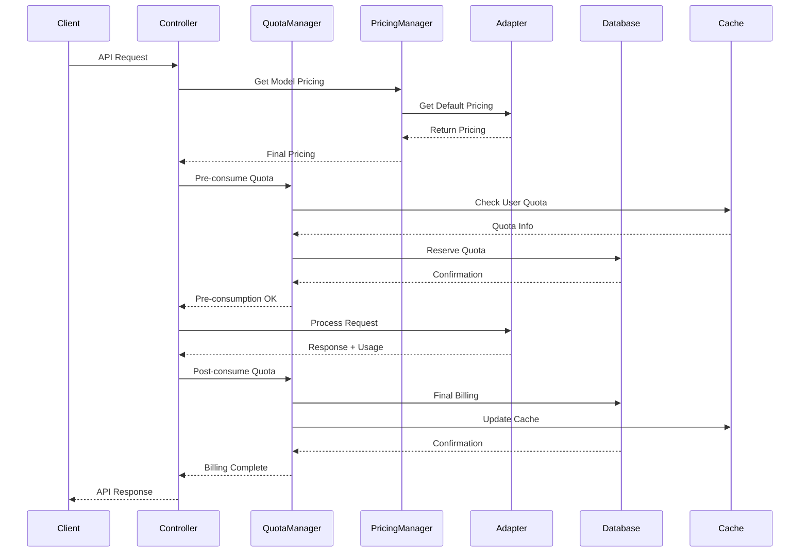
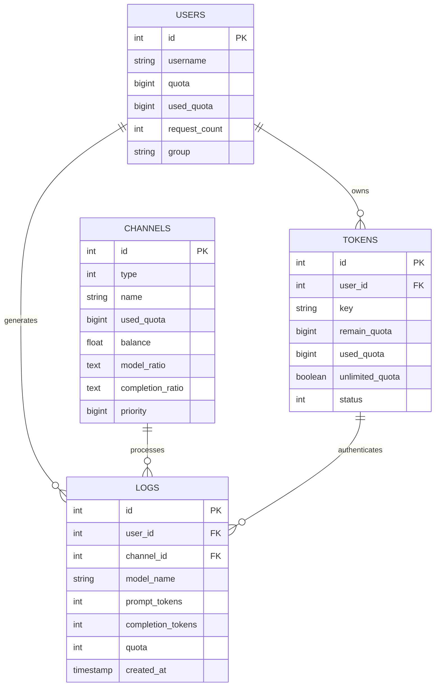
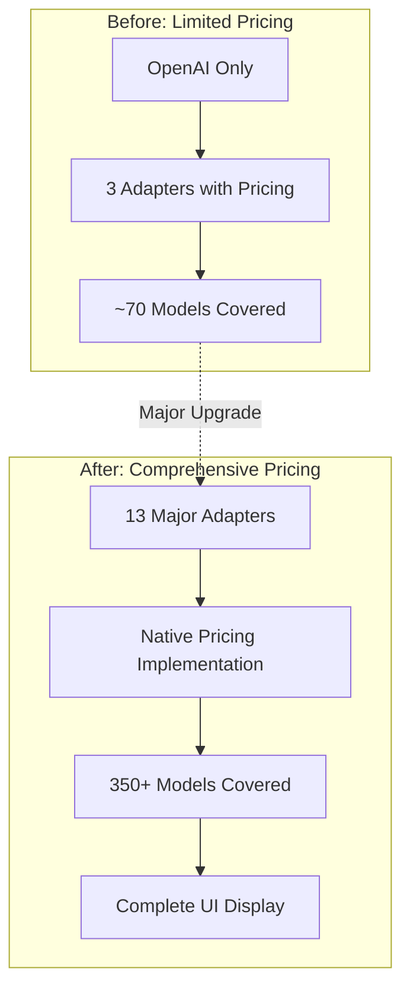
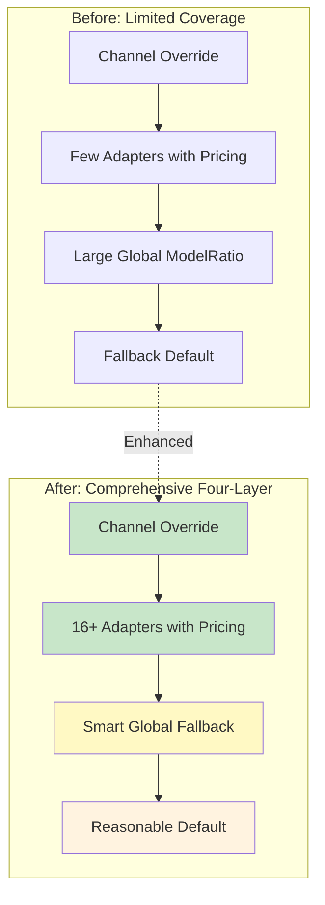
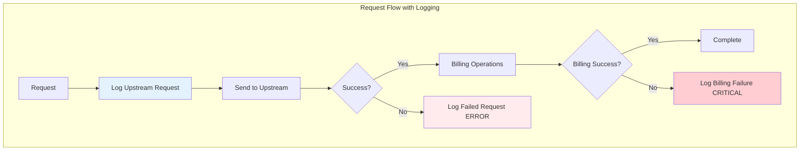

# One-API Billing System Architecture

## Table of Contents

- [One-API Billing System Architecture](#one-api-billing-system-architecture)
  - [Table of Contents](#table-of-contents)
  - [Overview](#overview)
    - [Key Features](#key-features)
  - [System Architecture](#system-architecture)
  - [Core Components](#core-components)
    - [1. Quota Management System](#1-quota-management-system)
      - [Key Files](#key-files)
    - [2. Pricing System](#2-pricing-system)
      - [Key Files](#key-files-1)
    - [3. Adapter System](#3-adapter-system)
      - [Adapter Pricing Implementation Status](#adapter-pricing-implementation-status)
  - [Quota Management](#quota-management)
    - [User Quota System](#user-quota-system)
      - [Database Schema (User)](#database-schema-user)
      - [Key Operations](#key-operations)
    - [Token Quota System](#token-quota-system)
      - [Database Schema (Token)](#database-schema-token)
      - [Token Types](#token-types)
    - [Caching Strategy](#caching-strategy)
      - [Key Files](#key-files-2)
  - [Pricing System](#pricing-system)
    - [Built-in Tool Alias Normalization (Anthropic Tool Search)](#built-in-tool-alias-normalization-anthropic-tool-search)
    - [Pricing Hierarchy](#pricing-hierarchy)
    - [Pricing Constants](#pricing-constants)
    - [Model Pricing Structure](#model-pricing-structure)
      - [Tier Resolution Engine](#tier-resolution-engine)
      - [Multimedia Pricing Merge Path](#multimedia-pricing-merge-path)
      - [Realtime (Live) Modality Rates](#realtime-live-modality-rates)
    - [Global Pricing System](#global-pricing-system)
      - [Architecture](#architecture)
      - [Configuration](#configuration)
      - [Key Functions](#key-functions)
      - [Conflict Resolution](#conflict-resolution)
    - [Channel-specific Pricing](#channel-specific-pricing)
      - [Database Schema (Channel)](#database-schema-channel)
      - [Key Functions](#key-functions-1)
  - [Billing Flow](#billing-flow)
    - [Request Processing Flow](#request-processing-flow)
    - [Pre-consumption Phase](#pre-consumption-phase)
      - [Key Functions](#key-functions-2)
    - [Post-consumption Phase](#post-consumption-phase)
      - [Key Functions](#key-functions-3)
    - [Paid Upstream Error Receipts](#paid-upstream-error-receipts)
    - [Provisional Request Cost Reconciliation (2025-09)](#provisional-request-cost-reconciliation-2025-09)
    - [Streaming Incremental Billing (2025-09)](#streaming-incremental-billing-2025-09)
    - [Quota Calculation](#quota-calculation)
      - [Text Requests](#text-requests)
      - [Audio Requests](#audio-requests)
      - [Image Requests](#image-requests)
    - [Universal Two-Step Image Billing (2025-08)](#universal-two-step-image-billing-2025-08)
  - [Database Schema](#database-schema)
    - [Core Tables](#core-tables)
      - [Users Table](#users-table)
      - [Tokens Table](#tokens-table)
      - [Channels Table](#channels-table)
      - [Logs Table](#logs-table)
    - [Relationships](#relationships)
  - [API Endpoints](#api-endpoints)
    - [Billing Endpoints](#billing-endpoints)
      - [Get Subscription Info](#get-subscription-info)
      - [Get Usage Info](#get-usage-info)
    - [Channel Pricing Endpoints](#channel-pricing-endpoints)
      - [Get Channel Pricing](#get-channel-pricing)
      - [Update Channel Pricing](#update-channel-pricing)
      - [Get Default Pricing](#get-default-pricing)
  - [Testing \& Race Condition Policy (2025-08)](#testing--race-condition-policy-2025-08)
    - [Token Management Endpoints](#token-management-endpoints)
  - [Recent Pricing Implementation Improvements](#recent-pricing-implementation-improvements)
    - [Comprehensive Adapter Pricing Implementation](#comprehensive-adapter-pricing-implementation)
      - [Implementation Overview](#implementation-overview)
      - [Key Improvements](#key-improvements)
      - [Technical Implementation Details](#technical-implementation-details)
      - [Provider-Specific Pricing Examples](#provider-specific-pricing-examples)
      - [Migration from DefaultPricingMethods](#migration-from-defaultpricingmethods)
      - [Impact and Benefits](#impact-and-benefits)
      - [Files Modified](#files-modified)
    - [Global Pricing Enhancement and Clean Architecture](#global-pricing-enhancement-and-clean-architecture)
      - [Architecture Transformation](#architecture-transformation)
      - [What Was Enhanced](#what-was-enhanced)
      - [What Was Preserved](#what-was-preserved)
      - [Benefits Achieved](#benefits-achieved)
  - [Implementation Details](#implementation-details)
    - [Current Implementation Status](#current-implementation-status)
    - [Four-Layer Pricing Resolution](#four-layer-pricing-resolution)
      - [Legacy Compatibility](#legacy-compatibility)
    - [Batch Processing](#batch-processing)
      - [Configuration](#configuration-1)
      - [Batch Types](#batch-types)
      - [Key Files](#key-files-3)
    - [Error Handling and Recovery](#error-handling-and-recovery)
      - [Quota Refund Mechanism](#quota-refund-mechanism)
      - [Key Files](#key-files-4)
    - [Structured Output Pricing](#structured-output-pricing)
      - [Key Notes](#key-notes)
  - [Performance Considerations](#performance-considerations)
    - [Caching Strategy](#caching-strategy-1)
    - [Database Optimization](#database-optimization)
    - [Memory Management](#memory-management)
    - [Monitoring and Metrics](#monitoring-and-metrics)
      - [Key Metrics](#key-metrics)
      - [Monitoring Files](#monitoring-files)
  - [Unbilled Request Logging System](#unbilled-request-logging-system)
    - [Logging Overview](#logging-overview)
    - [Implementation](#implementation)
    - [Log Levels and Keywords](#log-levels-and-keywords)
    - [Coverage Analysis](#coverage-analysis)
    - [Key Files](#key-files-5)
  - [Summary](#summary)

## Overview

The One-API billing system is a comprehensive quota and pricing management system designed to handle multi-tenant API usage billing across various AI model providers. The system supports both user-level and token-level quota management, channel-specific pricing, and real-time billing calculations.

**Current System Status (2025)**: The billing system now features comprehensive pricing coverage with 25+ adapters supporting 400+ models across major AI providers, implementing a sophisticated four-layer pricing resolution system with intelligent global fallback capabilities.

### Key Features

- **Multi-tier Quota System**: User quotas, token quotas, and unlimited quota support
- **Channel-specific Pricing**: Per-channel model pricing overrides
- **Comprehensive Adapter Pricing**: 25+ channel adapters with native pricing implementations
- **Complete Pricing Coverage**: 400+ models across major AI providers with accurate pricing
- **Four-Layer Pricing System**: Channel overrides → Adapter pricing → Global fallback → Final default
- **Real-time Billing**: Pre-consumption and post-consumption quota management
- **Caching Layer**: Redis-based caching for performance optimization
- **Batch Updates**: Configurable batch processing for high-throughput scenarios
- **Zero-Loss Pricing Display**: All completion ratios (including 0) are displayed in the UI

## System Architecture



## Core Components

### 1. Quota Management System

The quota management system operates on multiple levels:



#### Key Files

- `model/user.go` - User quota management
- `model/token.go` - Token quota management
- `model/cache.go` - Quota caching layer
- `relay/billing/billing.go` - Core billing operations

### 2. Pricing System

The pricing system uses a hierarchical approach with three fallback levels:



#### Key Files

- `relay/pricing/global.go` - Global pricing manager and four-layer pricing logic
- `relay/billing/ratio/model.go` - Audio/video pricing constants and legacy compatibility functions
- `relay/adaptor/interface.go` - Adapter pricing interface
- `relay/adaptor/*/models.go` - Adapter-specific pricing implementations (25+ adapters)
- `model/channel.go` - Channel-specific pricing storage
- `controller/channel.go` - Channel pricing API endpoints

### 3. Adapter System

All channel adapters now use a unified, centralized pricing logic. As of July 2025, 25+ major adapters import and use a shared `ModelRatios` constant from their respective `models.go` or subadaptor, eliminating local, hardcoded pricing maps and ensuring consistency across the system. **All pricing, quota, and billing calculations are standardized to use "per 1M tokens" (1 million tokens) as the pricing unit. All user-facing documentation and UI must use this unit.**

**All adapters must use the shared `ModelRatios` map as the single source of truth for model pricing. Local pricing maps are deprecated.**

For unknown models, all adapters use a unified fallback (e.g., `5 * ratio.MilliTokensUsd`). This ensures that even if a model is missing from the shared map, it will still be billed with a reasonable default. VertexAI pricing is aggregated from all subadapters (Claude, Imagen, Gemini, Veo) and includes VertexAI-specific models. Any omission in a subadapter will propagate to VertexAI.

Model lists are always derived from the keys of the shared pricing maps, ensuring pricing and support are always in sync.

**Key interface:**

```go
type Adaptor interface {
    GetDefaultModelPricing() map[string]ModelConfig
    GetModelRatio(modelName string) float64
    GetCompletionRatio(modelName string) float64
}
```

**Implementation details:**

- Each adapter's `GetDefaultModelPricing()` returns the shared `ModelRatios` map, which is the single source of truth for model pricing.
- Model lists are always derived from the keys of the shared pricing maps, ensuring pricing and support are always in sync.
- All adapters use a unified fallback (e.g., `5 * ratio.MilliTokensUsd`) for unknown models.
- VertexAI pricing is aggregated from all subadaptors (Claude, Imagen, Gemini, Veo) and includes VertexAI-specific models. Any omission in a subadaptor will propagate to VertexAI.
- All pricing, quota, and billing calculations are standardized to use "per 1M tokens" (1 million tokens) instead of "per 1K tokens". This is reflected in all code, comments, and documentation. Double-check all user-facing messages and documentation for consistency.

**Adapters with Native Pricing (25+ total):**

- OpenAI, Anthropic, Zhipu, Ali (Alibaba), Baidu, Tencent, Gemini, Xunfei, VertexAI, DeepSeek, Groq, Mistral, Moonshot, Cohere, AI360, Doubao, Novita, OpenRouter, Replicate, AWS, StepFun, LingYi WanWu, Minimax, Baichuan, TogetherAI, SiliconFlow, XAI

**Adapters using DefaultPricingMethods (fallback only):**

- Ollama, Coze, DeepL

All adapters now follow the same four-layer pricing system and fallback logic, with no local pricing map drift.

#### Adapter Pricing Implementation Status

**✅ Adapters with Native Pricing (25+ total)**:

- **OpenAI**: 84 models with comprehensive GPT pricing
- **Anthropic**: 28 models with Claude pricing
- **Zhipu**: 23 models with GLM pricing
- **Ali (Alibaba)**: 89 models with Qwen and other models
- **Baidu**: 16 models with ERNIE pricing
- **Tencent**: 6 models with Hunyuan pricing
- **Gemini**: 26 models with Gemini/Gemma pricing
- **Xunfei**: 6 models with Spark pricing
- **VertexAI**: 34 models with Google Cloud pricing
- **DeepSeek**: 2 models with DeepSeek pricing
- **Groq**: 15 current production/preview models plus 2 retired compatibility entries with Groq metadata
- **Mistral**: 10+ models with Mistral pricing
- **Moonshot**: 3 models with Moonshot pricing
- **Cohere**: 12 models with Command pricing
- **AI360**: 4 models with AI360 pricing
- **Doubao**: 20+ models with Doubao pricing
- **Novita**: 40+ models with Novita pricing
- **OpenRouter**: 100+ models with comprehensive multi-provider pricing
- **Replicate**: 48 models with image generation and language models
- **AWS**: 31 models with Bedrock pricing
- **StepFun**: 3 models with Step pricing
- **LingYi WanWu**: 3 models with Yi pricing
- **Minimax**: 3 models with abab pricing
- **Baichuan**: 2 models with Baichuan pricing
- **TogetherAI**: 40+ models with Together AI pricing
- **SiliconFlow**: 30+ models with SiliconFlow pricing
- **XAI**: current Grok text, image, and video catalog with context-tier pricing

**❌ Adapters Using DefaultPricingMethods (3 remaining)**:

- **Ollama**: Local model hosting (typically free)
- **Coze**: Conversational AI platform
- **DeepL**: Translation service

## Quota Management

### User Quota System

Users have a primary quota that serves as the main billing account:

#### Database Schema (User)

```sql
CREATE TABLE users (
    id INTEGER PRIMARY KEY,
    quota BIGINT DEFAULT 0,           -- Remaining quota
    used_quota BIGINT DEFAULT 0,     -- Total used quota
    request_count INTEGER DEFAULT 0   -- Total request count
);
```

#### Key Operations

- `IncreaseUserQuota()` - Add quota to user account
- `DecreaseUserQuota()` - Deduct quota from user account
- `GetUserQuota()` - Retrieve current user quota
- `CacheGetUserQuota()` - Cached quota retrieval

### Token Quota System

Tokens can have individual quotas or inherit from user quotas:

#### Database Schema (Token)

```sql
CREATE TABLE tokens (
    id INTEGER PRIMARY KEY,
    user_id INTEGER,
    remain_quota BIGINT DEFAULT 0,    -- Token-specific quota
    used_quota BIGINT DEFAULT 0,      -- Token usage
    unlimited_quota BOOLEAN DEFAULT FALSE  -- Bypass quota checks
);
```

#### Token Types

1. **Limited Tokens**: Have specific quota limits
2. **Unlimited Tokens**: Bypass quota restrictions
3. **User-inherited Tokens**: Use parent user's quota

### Caching Strategy

The system implements a multi-layer caching strategy for performance:



#### Key Files

- `model/cache.go` - Caching implementations
- Cache TTL configurations in `model/cache.go`

## Pricing System

### Built-in Tool Alias Normalization (Anthropic Tool Search)

Built-in tool charging and allowlist checks use canonical tool names (`relay/tooling`):

- Anthropic dated server tools map to their capability: `web_search_YYYYMMDD` -> `web_search`,
  `web_fetch_YYYYMMDD` -> `web_fetch`, `code_execution_YYYYMMDD` -> `code_execution`;
  `mcp_servers` / `mcp_toolset` -> `mcp_connector`.
- Tool Search (`tool_search_tool_regex`, `tool_search_tool_bm25` and versioned variants such as
  `tool_search_tool_regex_20251119`) maps to the distinct `tool_search` capability. Anthropic does not
  meter it, so it is admitted at a zero tariff and is never billed as `web_search`.

The Claude Messages route applies the same policy as Chat/Responses before reservation and dispatch
(`relay/controller/claude_messages_tool_policy.go`): every provider-executed capability must be
whitelisted and priced for the channel, unknown typed tools fail closed, and caller/client tools pass.
Paid tools reserve `max_uses` (default bound 10) x per-call price; native `usage.server_tool_use`
receipts (cumulative, merged by maximum) or, when absent, observed `server_tool_use` blocks are billed
once through `tooling.ApplyBuiltinToolCharges`.

### Pricing Hierarchy

The system uses a **comprehensive four-layer pricing hierarchy** to handle custom channels and unknown models:

1. **User Custom Ratio** (Channel-specific overrides) - Highest Priority
2. **Channel Default Ratio** (Adapter's default pricing) - Second Priority
3. **Global Pricing Fallback** (Merged from selected adapters) - Third Priority
4. **Final Default** (Reasonable fallback) - Lowest Priority

This four-layer approach ensures that custom channels with common models can automatically receive appropriate pricing even when the channel adapter doesn't have specific pricing for those models. The global pricing system merges pricing from 13 major adapters to provide comprehensive fallback coverage.

#### Effective tariff precedence

The effective tariff of a request is resolved once, at request start, for the mapped model: channel `model_configs` → adaptor (provider) defaults → global pricing → final default.

- **An explicit channel entry wins, including a stale one.** Updating a provider default in code does not change what a channel bills while its `model_configs` carries an entry for that model; the historical price stays effective until the operator edits or removes the entry.
- **Token prices merge field by field:** an entry's `ratio` or `completion_ratio` left at 0 inherits the provider value for that field only. Cache prices do not inherit: an entry without `cached_input_ratio` bills cached input at the entry's own input price (a negative value makes it free), so an override drops the provider's cache discount unless it sets one.
- **Admission and settlement use the same tariff.** The reservation (prompt estimate, plus `PreConsumedQuota` on the Chat Completions and Responses-to-Chat paths, plus `max_tokens` at the completion price), the final receipt charge and the reconciled `user_request_costs` row all use the resolved tariff. A provider that reports no usage, such as the AIProxy library API, settles at the reservation priced at that tariff.
- **Operator-only exception:** for models covered by `OperatorTariffPolicy` (below), only the channel entry can price the model; the lower layers are never consulted.

`relay/controller/effective_tariff_precedence_test.go` proves these rules end to end on Azure and native OpenAI channels for Chat Completions, Claude Messages and Responses clients, checking the balance, consume log and request cost against hand-computed charges.

#### Operator-only tariffs

A model name is not a pricing identity: a host can serve a model without a provider-qualified tariff for it (for example, the native-only OpenAI IDs `gpt-6-cyber` and `gpt-image-2.6-*` on Azure AI Foundry or the AIProxy library, Claude 5.2 and Gemini 4 Argon Cyber on Vertex AI, or legacy/trial slugs on xAI, Groq and Ali). An adaptor declares such models through `adaptor.OperatorTariffPolicy` (`RequiresOperatorTariff(model)`), and the system enforces the declaration at both boundaries:

- **Resolution:** every tariff resolver (`ResolveModelConfig`, `ResolveModelConfigRatioOnly`, `ResolveAudioPricing`, `ResolveImagePricing`, `GetVideoPricingWithThreeLayers`, `GetModelRatioWithThreeLayers`, `GetCompletionRatioWithThreeLayers`, `ResolveEffectivePricingForUsage`) consults only layer 1 for a declared model, so neither the adaptor's defaults nor another provider's global tariff can price it. Non-tariff limits such as context length and maximum output tokens remain available through `pricing.ResolveModelMetadata`, which admission uses for conservative output and context bounds.
- **Dispatch:** the adaptor implements `adaptor.RequestPricingValidator` and calls `pricing.ValidateOperatorTariff`, so `DoRequestHelper` rejects the request before any upstream contact unless the channel's `model_configs` carries a complete positive input and output tariff for the mapped model. `test/adaptor_pricing_wiring_test.go` proves this for every advertised declared model and fails if a provider declares the policy without the validator.
- **Refusal contract:** every caller runs the validator through `adaptor.ValidateRequestPricing` (REST dispatch in `DoRequestHelper`, and Claude Messages local admission before any reservation). A missing or incomplete tariff matches `adaptor.ErrRequestPricingNotConfigured` (`adaptor.IsRequestPricingNotConfigured`): validators mark only tariff refusals (`adaptor.RequestPricingNotConfigured`); other refusals, such as Groq's retired-model refusal or missing request metadata, keep their own semantics (Claude Messages: 400 `invalid_model_pricing`). A tariff refusal is a one-api configuration fault, never a client error: it never counts against channel health, and like a REST transport mismatch it is a local refusal that consumes no paid retry slot (`isLocalDispatchRefusal` in `controller/relay.go`), so the retry loop walks on to a priced candidate. If a provider was actually tried, the client sees that provider's failure; when every candidate refused, it receives HTTP 503 with code `model_pricing_not_configured` — the same contract as image requests' `image_billing_not_configured` — instead of a generic 500 `do_request_failed`. `controller/operator_tariff_relay_status_test.go` drives the real relay loop for Chat Completions and Claude Messages clients through the all-unpriced, fail-over, retry-budget, real-error-precedence and transport-failure (still 500) cases; before this contract a Claude Messages client got a terminal 400 even when a priced channel was available.
- **Pre-save warning:** the Modern channel editor posts the draft (`type`, comma-separated `models`, and the `model_mapping`/`model_configs` JSON text, encoded like the save payload) to the admin route `POST /api/channel/pricing-readiness` (`controller.CheckChannelPricingReadiness`). `relaycontroller.EvaluateChannelPricingReadiness` resolves the admission adaptor and runs, per Supported Model after Model Mapping, the admission validators themselves: the strict GPT Image reservation check (`image_price_per_image_usd`, reported only when the model has neither a positive `image.price_per_image_usd` nor an image-output token price to derive the calculator default from), `pricing.ValidateExplicitTokenTariffConfigs` (the request-free core of `RequireExplicitTokenPricing`, `token_tariff`), the provider's `pricing.OperatorTariffSupplementValidator` such as Vertex's cache prices (`tariff_supplement`), and `quota.ValidateRealtimeModelPricing` for Live-only Google models (`live_tariff`). The response is `{"success":true,"data":{"gaps":[{"model","upstream_model","requirement","message"}]}}`; bad or oversized drafts get HTTP 400. The editor shows the gaps in its save-warning dialog as confirm-to-save-anyway and fails open (no warning, a string-only console message) when the check errors. `relay/controller/channel_pricing_readiness_test.go` proves the verdict matches `adaptor.ValidateRequestPricing` for every shipped catalog, and `channel_pricing_readiness_image_test.go` matches it against `RelayImageHelper`.

Native-only OpenAI IDs are listed once, in `openai.IsNativeOnlyModel`; hosts that inherit OpenAI's catalog derive their discovery and pricing from `openai.InheritedModelRatios()`/`InheritedModelList()` instead of maintaining their own exclusion lists.

GPT Image 2.6 generations on these hosts need no `image.price_per_image_usd`: once the channel sets `ratio` and `completion_ratio`, the per-image reservation and fallback charge default to OpenAI's calculator estimate priced at the channel's output-token price (see `docs/usage/openai-image25-billing.md`). A positive `image.price_per_image_usd` remains an optional override. Without channel token prices the request is still refused with `503 image_billing_not_configured`, and the readiness check reports both `token_tariff` and `image_price_per_image_usd`. A usable receipt settles at the channel's token prices. The AIProxy library has no image endpoint, so the distributor never routes image requests to it.

End-to-end coverage, with a fake provider and the SQLite ledger:

- `relay/controller/operator_tariff_effective_pricing_test.go`: `gpt-6-cyber` on Azure and the AIProxy library, for Chat Completions, Claude Messages and Responses clients.
- `relay/controller/operator_tariff_image_test.go`: GPT Image 2.6.

Both prove that an unpriced channel is refused with zero upstream calls and a full refund, and that a priced channel is dispatched once and charged exactly the operator tariff.

### Pricing Constants

```go
// Currency and token conversion constants
const (
    QuotaPerUsd     = 500000 // $1 = 500,000 quota
    ExchangeRateRmb  = 8
    MilliTokensUsd  = 0.5    // 0.5 quota per milli-token (0.000001 USD * 500000)
    MilliTokensRmb  = MilliTokensUsd / ExchangeRateRmb
    TokensPerSec    = 10     // Video tokens per second for video generation models
)
```

### Model Pricing Structure

```go
type ModelConfig struct {
    Ratio             float64              `json:"ratio"`
    CompletionRatio   float64              `json:"completion_ratio,omitempty"`
    CachedInputRatio  float64              `json:"cached_input_ratio,omitempty"`
    CacheWrite5mRatio float64              `json:"cache_write_5m_ratio,omitempty"`
    CacheWrite1hRatio float64              `json:"cache_write_1h_ratio,omitempty"`
    Tiers             []ModelRatioTier     `json:"tiers,omitempty"`
    MaxTokens         int32                `json:"max_tokens,omitempty"`
    Video             *VideoPricingConfig  `json:"video,omitempty"`
    Audio             *AudioPricingConfig  `json:"audio,omitempty"`
    Image             *ImagePricingConfig  `json:"image,omitempty"`
    Embedding         *EmbeddingPricingConfig `json:"embedding,omitempty"`
    ContextLength     int32                `json:"context_length,omitempty"`
    MaxOutputTokens   int32                `json:"max_output_tokens,omitempty"`
    InputModalities   []string             `json:"input_modalities,omitempty"`
    OutputModalities  []string             `json:"output_modalities,omitempty"`
    SupportedFeatures []string             `json:"supported_features,omitempty"`
    SupportedSamplingParameters []string   `json:"supported_sampling_parameters,omitempty"`
    SupportedReasoningEfforts []string     `json:"supported_reasoning_efforts,omitempty"`
    DefaultReasoningEffort    string       `json:"default_reasoning_effort,omitempty"`
    MaxReasoningTokens        int32        `json:"max_reasoning_tokens,omitempty"`
    Quantization     string                `json:"quantization,omitempty"`
    HuggingFaceID    string                `json:"hugging_face_id,omitempty"`
    Description      string                `json:"description,omitempty"`
}

type ModelRatioTier struct {
    Ratio             float64 `json:"ratio"`
    CompletionRatio   float64 `json:"completion_ratio,omitempty"`
    CachedInputRatio  float64 `json:"cached_input_ratio,omitempty"`
    CacheWrite5mRatio float64 `json:"cache_write_5m_ratio,omitempty"`
    CacheWrite1hRatio float64 `json:"cache_write_1h_ratio,omitempty"`
    InputTokenThreshold int  `json:"input_token_threshold"`
    OutputTokenThreshold int `json:"output_token_threshold,omitempty"`
}
```

- **Tiered pricing**: Adapters can attach sorted `tiers` to alter input, completion, and cache-write prices once a request crosses input and optional output token thresholds. `pricing.ResolveEffectivePricingForUsage()` applies both dimensions at runtime and records which thresholds were selected for observability.
- **Cache-aware pricing**: `CachedInputRatio`, `CacheWrite5mRatio`, and `CacheWrite1hRatio` let adapters express Anthropic-style prompt caching economics. Negative values mark a bucket as free; zero means “inherit the base ratio.”
- **Time-of-day pricing**: `time_windows` attach ordered wall-clock overlays to a model config. The resolver selects the first window matching `meta.StartTime`, deep-merges its sparse pricing overlay, clears `TimeWindows`, and then applies tiers. Windows use explicit IANA timezones, support daylight-saving changes through local wall-clock conversion, midnight-crossing ranges, optional weekday filters, and optional local-date bounds.
- **Max token policy**: `MaxTokens` carries per-model token ceilings so controllers can clamp `max_tokens` before dispatching upstream.
- **Multimedia metadata**: `Video`, `Audio`, and `Image` pointers hold secondary pricing dimensions (per-second, per-minute, or per-image tables) alongside text token billing. These blobs travel through the three-layer resolver so channel overrides, adapter defaults, and global fallbacks stay consistent across media types.
- **Capability metadata**: `ContextLength`, `MaxOutputTokens`, `InputModalities`, `OutputModalities`, `SupportedFeatures`, `SupportedSamplingParameters`, `Quantization`, and `HuggingFaceID` describe the model surface so adaptors, request transformers, and the admin UI can advertise what each model actually accepts.
- **Reasoning metadata**: `SupportedReasoningEfforts` enumerates the discrete `reasoning_effort` levels a model accepts (subset of `minimal`/`low`/`medium`/`high`). `DefaultReasoningEffort` is the level applied when callers omit one. `MaxReasoningTokens` caps providers that use a budget instead of a level (Anthropic `thinking.budget_tokens`, Gemini `thinkingBudget`). Reasoning-aware request transformers read these fields data-first, falling back to model-name heuristics only when the config is empty.

`VideoPricingConfig`, `AudioPricingConfig`, and `ImagePricingConfig` define the knobs administrators see in the UI: duration-based USD prices, prompt-to-token conversion ratios, render-based size/quality multipliers, and min/max batch sizes. Channel overrides merge on top of adapter defaults, and unresolved fields inherit from the previous layer to avoid surprises.

#### Tier Resolution Engine

- `pricing.ResolveEffectivePricing(modelName, inputTokens, adaptor)` collapses the base config plus tier overrides into an `EffectivePricing` struct before quotas are debited.
- `pricing.ApplyTimeWindow(config, at)` applies request-start pricing windows before tier resolution. Billing paths pass the request start time; read-only model display previews pass display time.
- Tier thresholds are inclusive (>=) and the resolver tracks the winning threshold for observability and debugging.
- Optional tier fields inherit from the previous layer unless explicitly overridden, so you only configure what changes at that scale break.
- If no adapter pricing exists, the resolver falls back to adapter-provided defaults (`GetModelRatio()` / `GetCompletionRatio()`) and, failing that, the final USD-per-million default.

#### Multimedia Pricing Merge Path

- `pricing.GetVideoPricingWithThreeLayers()` mirrors the token pricing hierarchy for video metadata: channel override → adapter → global fallback. `/v1/videos` follows the same per-block rule as image pricing: a channel entry without a `video` block (only a scalar `ratio`, say) keeps the provider's per-second tariff instead of failing with `video_pricing_missing`, while a channel `video` block replaces it (`relay/controller/video_channel_fallback_test.go`).
- Token billing (`ResolveModelConfigRatioOnly`) keeps a channel entry's `embedding` block, as it keeps the provider's: modality token ratios and per-unit embedding prices apply outside time windows too, not only inside one (`relay/quota/quota_channel_embedding_test.go`).
- Audio and image configs piggy-back on the same `cloneModelConfig()` pathway, so all multimedia pricing features stay in sync when global pricing is rebuilt.
- Controllers read these merged configs to compute per-second and per-image quotas (e.g., `relay/controller/video.go`, `relay/controller/image.go`) while still charging prompt tokens through the tiered resolver.
- `VideoPricingConfig.ResolutionMultipliers`, `AudioPricingConfig.PromptTokensPerSecond`, and `ImagePricingConfig.QualitySizeMultipliers` let adapters express tiered pricing for 720p vs 4K renders, streaming vs transcription seconds, and HD vs SD images without duplicating models; those multipliers remain editable at the channel layer.

#### Realtime (Live) Modality Rates

Realtime receipts (OpenAI Realtime, Gemini Live, Vertex AI Live) are priced per modality in `relay/quota/realtime.go` and `relay/quota/gemini_live.go`. Every modality price is a ratio, so time windows and context tiers that change `ratio` move all of them together:

| Receipt bucket | Channel `model_configs` key | Rate |
| --- | --- | --- |
| Text input / output | `ratio`, `completion_ratio` | `ratio`, `ratio × completion_ratio` |
| Audio input / output | `audio.prompt_ratio`, `audio.completion_ratio` | `ratio × prompt_ratio`, audio input × `completion_ratio` |
| Image and video input (Gemini Live) | `image.prompt_ratio` | `ratio × prompt_ratio` |
| VIDEO output (Gemini Live avatar) | `video.output_token_ratio` | `ratio × output_token_ratio` |

Vertex AI requires explicit Live rates. `ValidateRealtimeModelPricing` requires `completion_ratio`, both audio ratios and `image.prompt_ratio`. It does not require `video.output_token_ratio`. When a receipt attributes response tokens to `VIDEO` and no layer sets the key, the tokens are charged with the unattributed output at the cheaper of text and audio output. The receipt is flagged unpriced (`video output` billing issue, `realtime_billing_complete=false`) rather than settled as exact. This was the only behaviour before the key existed. Example for Gemini 3.8 Live on Vertex (Non-global, [Vertex AI pricing](https://cloud.google.com/vertex-ai/generative-ai/pricing), checked 2026-11-18: text $0.75 in / $4.50 out, audio $3.00 / $12.00, video/image input $1.00, "Output: video (avatar)" $1.00 per 1M tokens):

```json
{"gemini-3.8-live": {"ratio": 0.375, "completion_ratio": 6,
  "audio": {"prompt_ratio": 4, "completion_ratio": 4},
  "image": {"prompt_ratio": 1.3333333333333333},
  "video": {"output_token_ratio": 1.3333333333333333}}}
```

`video.output_token_ratio` is a realtime token rate, not a video-generation tariff. `VideoPricingConfig.HasData()` ignores it, so a Live model's `video` block never enables per-second video billing. It resolves through `pricing.ResolveRealtimeVideoOutputRatio` (channel override, then provider defaults and global catalog unless the provider declares an operator-only tariff), merges in `time_windows` overlays, and is ignored unless positive and finite. Only tokens the provider explicitly attributes to `VIDEO` use it; an unattributed remainder never does. Regression coverage: `relay/quota/realtime_video_output_tariff_test.go` and `controller/vertex_live_video_output_test.go`.

### Global Pricing System

The global pricing system provides a third layer of pricing fallback for custom channels that offer common models but don't have specific pricing defined in their adapters.

#### Architecture

The global pricing manager automatically merges pricing from selected adapters on startup:

```go
type GlobalPricingManager struct {
    globalModelPricing    map[string]adaptor.ModelConfig
    contributingAdapters  []int // API types to include
    getAdaptorFunc        func(apiType int) adaptor.Adaptor
}
```

#### Configuration

Global pricing adapters are defined as a simple slice in the code for easy modification:

```go
// DefaultGlobalPricingAdapters defines which adapters contribute to global pricing fallback
var DefaultGlobalPricingAdapters = []int{
    apitype.OpenAI,    // Comprehensive GPT models with pricing
    apitype.Anthropic, // Claude models with pricing
    apitype.Gemini,    // Google Gemini models with pricing
    apitype.Ali,       // Alibaba Qwen models with pricing
    apitype.Baidu,     // Baidu ERNIE models with pricing
    apitype.Zhipu,     // Zhipu GLM models with pricing
    apitype.DeepSeek,  // DeepSeek models with pricing
    apitype.Groq,      // Groq models with pricing
    apitype.Mistral,   // Mistral models with pricing
    apitype.Moonshot,  // Moonshot models with pricing
    apitype.Cohere,    // Cohere models with pricing
    apitype.Tencent,   // Tencent Hunyuan models with pricing
    apitype.Xunfei,    // Xunfei Spark models with pricing
}
```

#### Key Functions

- `GetModelRatioWithThreeLayers()` - Four-layer pricing resolution
- `GetCompletionRatioWithThreeLayers()` - Four-layer completion ratio resolution
- `SetContributingAdapters()` - Configure which adapters contribute to global pricing
- `ReloadGlobalPricing()` - Force reload of global pricing from adapters
- `GetGlobalPricingStats()` - Get statistics about global pricing coverage

#### Conflict Resolution

When multiple adapters define pricing for the same model, the first adapter in the configuration list takes precedence. Conflicts are logged for transparency.

### Channel-specific Pricing

Channels can override default pricing for specific models:

#### Database Schema (Channel)

```sql
CREATE TABLE channels (
    id INTEGER PRIMARY KEY,
    model_ratio TEXT,        -- JSON: {"model": ratio}
    completion_ratio TEXT    -- JSON: {"model": completion_ratio}
);
```

#### Key Functions

- `GetModelRatio()` - Retrieve channel model pricing
- `SetModelRatio()` - Update channel model pricing
- `GetCompletionRatio()` - Retrieve completion pricing
- `SetCompletionRatio()` - Update completion pricing

## Billing Flow

### Request Processing Flow



### Pre-consumption Phase

Before processing requests, the system reserves quota:

#### Key Functions

- `preConsumeQuota()` in `relay/controller/text.go`
- `getPreConsumedQuota()` for quota calculation
- Token validation and quota checking

### Post-consumption Phase

After request completion, final billing is calculated:

#### Key Functions

- `postConsumeQuota()` in `relay/controller/helper.go`
- `PostConsumeQuota()` in `relay/billing/billing.go`
- Usage logging and metrics recording

### Paid Upstream Error Receipts

A non-2xx provider response normally proves no completed work. An explicit 4xx answer means the provider rejected the request before inference (invalid body, authentication, permission, unknown model, conflict, payload size, unprocessable input, rate limit or request timeout), so its admission hold is refunded at once whether or not the relay retries (`recordUpstreamClientRejection`; Jina and Cohere keep their own documented rejection statuses). A 5xx answer is uncertain: the attempt keeps its retained hold, the retry loop refunds it before failing over (`ResetPerAttemptBillingForRetry`), and a terminal failure keeps it visibly (see below). A provider can, however, report billable work in an error body. Before deciding to refund or replay, the Chat Completions, native Responses, Responses-through-Chat, Claude Messages and MCP-round paths call `paidUpstreamErrorUsage`, which reads at most `adaptor.MaxPaidErrorReceiptBytes` (1 MiB) of the body, restores it for unchanged error rendering, and asks the serving adaptor's `adaptor.PaidErrorReceiptReader`:

- **Native OpenAI and Azure OpenAI** (`openai.Adaptor`, `azure.Adaptor`) accept an explicit receipt only: a root `usage` object (Chat style or a Responses object) or a failed Responses envelope's `response.usage`, with at least one positive counter. OpenAI's documented error schema carries no usage, so this closes a possible rather than an observed window. Foundry Claude deployments and every other provider return nil.
- **A receipt is settled, not refunded:** the attempt is billed exactly like a 2xx response with the same usage (tiers, cache, service tier and the GPT-6 Cyber pricing guard included) plus the web searches a failed Responses envelope lists, the client still receives the provider error, and `markResponseSettlement` vetoes a cross-channel replay. In an MCP tool loop the paid round's usage is retained by the loop.
- **No receipt:** a 4xx is refunded; a 5xx keeps its retained hold (refunded on fail-over, published when terminal). Either way the error stays retryable.

`relay/controller/paid_upstream_error_test.go` proves that a paid 500 settles exactly the charge of the same 2xx receipt for gpt-4o-mini and gpt-6-cyber on native OpenAI (Chat, Responses fallback, native Responses, Claude Messages) and gpt-4o-mini on Azure, and that a plain 500 keeps only the retained hold and stays retryable. `relay/controller/paid_upstream_error_matrix_test.go` extends this to HTTP 400, 429 and 500 with and without a receipt. It checks the user balance, token `remain_quota`, consume log, `user_request_costs` and the retry veto, plus Cyber receipt dimensions: a non-Standard tier and 12h writes stay unpriced estimates, and 30m writes bill at the $25/M write rate. The router-level suite `router/e2e_paid_error_test.go` drives the same matrix through the shipped router with a failing primary and a healthy secondary channel.

### Oversized Receipts (2026-11)

`relay/model.ResponseUsageAccumulator` observes provider bytes for billing without retaining a whole response: it keeps at most 2 MiB of a JSON body or of one SSE event. Providers put the receipt after the bytes that make a response large (OpenAI renders `service_tier` and `usage` after `output`, and a Responses stream restates both in `response.completed`, whose `output` repeats every item), so a reasoning `encrypted_content`, an image result or long text used to push the receipt out of the window. The observer then billed estimates: the Claude Messages stream converter, whose only usage source is this accumulator, settled a 10,500-quota gpt-4o-mini receipt at its 78-quota reservation, and native GPT-6 Cyber responses lost their actual service tier and retained their whole reservation.

Past the window the accumulator now hands the envelope to `responseReceiptScanner` (`relay/model/response_usage_scanner.go`), a byte-level JSON follower that retains only the receipt members `consumeJSON` reads: root `type`, `usage`, `service_tier` and `system_fingerprint`, and `usage`/`service_tier` inside a root `response` or `message` object. Memory is bounded by those members (64 KiB each); string content is skipped at memory-scan speed (~3.7 GB/s). Member names are unescaped and later duplicates replace earlier ones, exactly as `encoding/json` decodes the in-window path, and `TestResponseUsageOversizedEnvelopeDifferential` proves an oversized envelope yields the same receipt as the same envelope without its padding for Responses, Chat Completions and Claude, JSON and SSE.

An oversized envelope the scanner cannot follow (cut off, malformed, a root array, trailing data, or an oversized receipt member) keeps the previous behavior: missing counters are labelled `response_usage_capture_limit` and settlement retains at least the reservation. Its actual tier is unknown, so the accumulator also sets the server-only `Usage.ServiceTierUnverified` (cleared when a later Responses terminal event restates the receipt). A tier-restricted tariff (`ModelBillingPolicy.SupportedServiceTiers`, e.g. GPT-6 Cyber and GPT-6.1 Terra) treats such a receipt as unpriced instead of assuming Standard; MCP tool rounds that ran on different tiers are merged as unverified for the same reason. Router coverage: `router/e2e_cyber_oversized_test.go`.

### Megapixel Image Tariffs (2026-11)

Some image hosts price by output and reference-image area rather than per image. A catalog entry opts in with `ImagePricingConfig.Megapixel` (`adaptor.ImageMegapixelPricing`). The block holds:

- the first-megapixel price and the additional-megapixel price;
- the reference-image price per megapixel;
- the pixels per megapixel and the rounding rule (`ceil` per started megapixel, or `exact` pro-rata);
- the output size step;
- a fallback megapixel count for references whose dimensions cannot be measured.

`pricing.QuoteImageMegapixels` prices one request with exact fractions. The image controller (`relay/controller/image_megapixel.go`) quotes before the reservation, so the hold and the settlement are the same charge. Models without the block bill exactly as before.

- **DeepInfra FLUX-2-max / FLUX-2-pro:**
  - Rates are Black Forest Labs' pass-through tariff: max $0.07 first MP plus $0.03 per additional MP; pro $0.03 plus $0.015.
  - A megapixel is 1024x1024 px. Every started megapixel is billed, separately for the output and for each reference image, and sides round up to a multiple of 32.
  - Reference images are measured from multipart uploads with `image.DecodeConfig`. An unmeasurable reference is billed at 16 MP and flagged `image_reference_dimensions_unknown_fallback`.
  - Previously both were flat per image, which under-billed outputs above 1 MP, every edit, and every FLUX-2-pro request (its headline price was the additional-MP rate).
- **Together AI:**
  - Together's image API has no `size` field and renders the raw `width`/`height` it receives.
  - For Together channels (`relay/controller/image_together.go`), the gateway resolves one billed size: the client's `width`/`height`, else its `size`, else the model default. It prices that size and forwards it as `width`/`height`.
  - Per-MP models (FLUX.2-max, Kontext, FLUX1.1-pro) use the exact pro-rata tariff, `MP = W x H / 1e6`. Steps above the published default add a `steps / default` surcharge.
  - Per-image models use a megapixel tariff floored at their listed price.
  - Conflicting `size` and `width`/`height`, ambiguous key spellings, non-JSON bodies and `aspect_ratio` on size-priced models are refused with 400.

Regression: `router/e2e_deepinfra_megapixel_test.go`, `router/e2e_togetherai_image_test.go`.

### Provider-Reported Cost Floor (OpenRouter)

OpenRouter lists each model at its top provider's price but load-balances requests across providers whose prices can be 10-200x higher. It reports the real charge of every request in `usage.cost` (USD; for BYOK, `cost` plus `cost_details.upstream_inference_cost`) on Chat and Responses JSON and on the terminal SSE usage frame. An adaptor that implements `adaptor.ReportedCostBillingPolicy` (the OpenAI adaptor for OpenRouter channels, and the dedicated OpenRouter adaptor) makes settlement charge `max(catalog price, ceil(cost x QuotaPerUsd x group ratio))` (`relay/quota/reported_cost.go`); a free group stays free and a cheaper reported cost keeps the catalog price. `openrouter.ObserveReportedCost` reads the cost from the raw body before presentation converters run and attaches it to the settled usage as `Usage.UpstreamCostUSD` (`json:"-"`, never serialized), and `openrouter.ScrubReportedCostLine` removes `cost`, `is_byok` and `cost_details` from streamed Chat usage chunks so clients never see the operator's provider cost. Previously such requests settled at the listed promo price, e.g. 7,150 quota for a request OpenRouter charged $10 (5,000,000 quota). Regression: `router/e2e_openrouter_cost_test.go`.

#### Terminal retained reservations

When the conservative policy keeps a possibly-forwarded attempt's hold, the attempt is marked pending, because no receipt proved its cost. A cross-channel retry refunds a pending hold (`ResetPerAttemptBillingForRetry`). When the relay stops retrying, `controller.Relay` calls `SettleTerminalRetainedReservation`. It publishes the hold without another debit: the provisional log becomes a consume log flagged `billing_estimated` with reason `retained_reservation_<refund reason>`, used quota grows by the hold, and `user_request_costs` records it. Before this, a terminal failure kept the debit but every ledger except the wallet showed nothing. That includes an explicit `RetryTimes=0`, where every upstream 5xx is terminal (a 4xx is refunded instead, see above). The provisional row stayed filtered out of every Logs query, and `user_request_costs` was reset to 0. The amount charged is unchanged, so only visibility differs. Regression: `router/e2e_regressions_test.go` (`TestE2ETerminalErrorHoldIsVisible`) and `controller/incident_body_reset_*_test.go`.

### Native OpenAI Prompt-Cache Admission (2026-11)

OpenAI's GPT-5.6+ prompt-cache contract ([prompt caching guide](https://developers.openai.com/api/docs/guides/prompt-caching.md)) bills cache **writes**, and caching is on by default. Without `prompt_cache_options.mode = "explicit"`, OpenAI places one implicit breakpoint and bills the written prefix as a 30-minute write (1.25× uncached input). Explicit `prompt_cache_breakpoint` controls (on content parts, including `function_call_output` output) add writes. `mode = "explicit"` without any breakpoint disables caching, so the request has no write and no read. A 12h lifetime bills 2.5× input and is not metered here.

`openai.ImplicitPromptCacheWrites` (native OpenAI channel + catalog entry with a `CacheWrite5mRatio`) selects the models this applies to. `openai.InspectPromptCacheWriteIntent` is the single parser for these controls, used by both the request guard and admission. Every tiered admission path calls `decideTierAdmissionCacheWrites`: Chat, native Responses, Claude Messages, MCP rounds and WebSocket frames.

- **Short-context tiers fund implicit writes.** The hold prices the whole admitted prompt at `max(input, 30m write)`, so it covers the highest charge the request can incur. Previously the hold assumed no write and under-covered GPT-6 Cyber by 20% of the prompt cost.
- **Unpublished write tiers are disabled, not guessed.** OpenAI publishes no GPT-6 Cyber cache-write price above 272,000 input tokens (`ModelBillingPolicy.CacheWriteUnpricedFromInputTokens`). `pricing.CacheWriteUnpriced` is shared by admission and settlement. Unless an explicit operator tier supplies `cache_write_5m_ratio`:
  - Explicit client write controls are refused with HTTP 400 before dispatch: breakpoints, `mode = "implicit"`, or `prewarm`.
  - Requests without such controls are pinned to `prompt_cache_options.mode = "explicit"`. Admission records the pin with `openai.SetPromptCacheExplicitPin`, and `openai.Adaptor.DoRequest` applies it to exactly that channel/model attempt. The receipt then has no write and settles exactly at the published long-context rates.
  - Previously, implicit caching wrote nearly every long-context request. Each such receipt settled the whole reservation as an unpriced estimate (2.2× the exact charge in the regression fixture).
- **Residual window.** The tier is chosen on the admission estimate. A request estimated just below 272,001 tokens whose actual input crosses the threshold can still write in the unpriced tier. Such a receipt stays an unpriced estimate (`unpriced_usage_retained_reservation`, at least the reservation), and its writes are priced no lower than OpenAI's documented generic 30m rule, 1.25x the tier's uncached input (`ModelBillingPolicy.UnpricedCacheWriteInputMultiplier`), instead of the cheaper short-context write rate the tier resolver would otherwise inherit.
- **Client options are honored.** For metered models, a sanitized `prompt_cache_options` (`mode`, `ttl`, `prewarm`, lower-cased) is forwarded on the native Responses route. `comparison_response_id` diagnostics are dropped because they reference provider response IDs outside the gateway's ownership model. Before, the field was always stripped, so a client that opted out of implicit writes was still billed for them. Other channels and models keep never forwarding the field.
- **Client control refusals are HTTP 400.** These are marked `adaptor.ErrUnbillableRequestControl` and mapped to 400 `invalid_request_error` at every conversion boundary (`wrapConvertRequestError`): unsupported service tiers, unmetered lifetimes, malformed cache controls, and unpriced explicit writes. They previously surfaced as 500 `convert_request_failed`.

Regression coverage: `relay/controller/native_prompt_cache_billing_test.go` (HTTP ledgers for Chat, Responses and Claude Messages), `relay/controller/native_prompt_cache_admission_test.go` (the 272,000/272,001 boundary, scope and 400 mapping), and `relay/adaptor/openai/prompt_cache_contract_test.go` (parser, sanitizer, attempt-scoped pin).

### Provisional Request Cost Reconciliation (2025-09)

To prevent lost billing in early client disconnect scenarios, controllers now record a provisional per-request cost at dispatch and reconcile to the final cost when usage becomes available.

Flow:

1. After `DoRequest` succeeds, write a provisional `UserRequestCost` for the `request_id` using the estimated pre-consumed quota (prompt tokens + max output tokens × pricing), even if physical pre-consume is skipped for trusted users/tokens.
2. If upstream responds with a non-success HTTP status, apply conservative reconciliation:
   - if the request was not forwarded upstream, refund pre-consumed quota and set provisional `UserRequestCost` to `0`;
   - if the request may already have reached upstream, skip refund to avoid underbilling and rely on post-consume/provisional reconciliation.
3. When usage arrives, compute the final quota using the detailed pricing formula and reconcile the record by overwriting the provisional value. Token/user/channel updates use the delta between pre- and post-consumption.

Controllers:

- Text/Chat (`relay/controller/text.go`)
- Response API (`relay/controller/response.go`)
- Claude Messages (`relay/controller/claude_messages.go`)
- Images (`relay/controller/image.go`) — per-image pre-consume + usage override (e.g., `gpt-image-1` / `gpt-image-1-mini`)
- Audio (`relay/controller/audio.go`)

Helper:

- `model.UpdateUserRequestCostQuotaByRequestID(userID, requestID, quota)` creates or updates the `user_request_costs` row keyed by `request_id`.

### Streaming Incremental Billing (2025-09)

- Streaming controllers for chat/text responses now charge completion usage in near real time while the upstream connection is still open. Instead of waiting for the final chunk, the billing subsystem flushes usage every few seconds.
- The default flush cadence is **3 seconds** and can be tuned with the `STREAMING_BILLING_INTERVAL` environment variable (value in seconds).
- If an incremental flush detects that the user no longer has sufficient quota, the stream is cut off immediately and an SSE error frame is emitted to the caller before the upstream sends additional tokens.
- Final reconciliation subtracts the pre-consumed reservation and the already-charged incremental amount to avoid double billing and ensures the `usage` record remains authoritative.

### Quota Calculation

Different request types use different calculation methods:

#### Text Requests

Base formula (no caching):

```
quota = (prompt_tokens + completion_tokens * completion_ratio) * model_ratio * group_ratio
```

Claude prompt caching extends billing with cache-read and cache-write costs. We split prompt tokens into: normal input, cached-read input, and cache-write input (5m and 1h). Completion tokens are always billed at the output price.

```
normal_input = prompt_tokens - cached_read - cache_write_5m - cache_write_1h

quota =
    normal_input        * input_price
+ cached_read         * cached_input_price
+ completion_tokens   * output_price
+ cache_write_5m      * write5m_price
+ cache_write_1h      * write1h_price

where:
    input_price           = model_ratio * group_ratio
    output_price          = model_ratio * completion_ratio * group_ratio
    cached_input_price    = (CachedInputRatio if >0 else input_price) or 0 if <0
    write5m_price         = (CacheWrite5mRatio if >0 else input_price) or 0 if <0
    write1h_price         = (CacheWrite1hRatio if >0 else input_price) or 0 if <0
```

Notes:

- We prevent double-charging by subtracting cache-write tokens from the normal-input bucket; values are clamped to avoid negatives if upstream reports inconsistent totals.
- For Anthropic Claude, cached-read tokens come from `usage.cache_read_input_tokens`. Cache-write tokens come from `usage.cache_creation.ephemeral_5m_input_tokens` and `usage.cache_creation.ephemeral_1h_input_tokens` (or the legacy `cache_creation_input_tokens`). See `docs/refs/claude_prompt_caching.md`.

#### Audio Requests

```
quota = audio_duration_seconds * audio_tokens_per_second * model_ratio * group_ratio
```

#### Image Requests

### Universal Two-Step Image Billing (2025-08)

The billing system now implements a universal, robust two-step billing process for all image-centric models (e.g., DALL·E 2/3, GPT Image 1 family):

**1. Pre-consume:**

- Before sending the request, the system pre-consumes quota based on a fixed per-image price (`image.price_per_image_usd`), multiplied by the appropriate size/quality tier and group ratio.
- Strict GPT Image 2.5/2.6 models have no catalog per-image price: when the channel sets no positive `image.price_per_image_usd` (an optional override), the per-image amount defaults to OpenAI's cost-calculator estimate of the request's image-output tokens (an `auto` or unpriced size/quality resolves to its most expensive case) at the effective output-token price, plus the prompt's UTF-8 byte count at the text-input price spread across the images (`strictGPTImageDefaultReservationUSD`). It prices what the provider renders: the normalized request when the relay re-encodes the body, or the client's own values (omitted size/quality = `auto`) when the body is forwarded verbatim; either body keeps the client's `stream` and `partial_images`, and each requested partial image adds 100 output tokens. It is multiplied by group ratio and image count like a configured price, but size/quality tier multipliers never apply to it (they scale a configured price only). With either reservation source the held and fallback-charged image count is the count the provider renders: the normalized `n` of a re-encoded body, or the client's own positive `n` of a verbatim body (a gateway-only `min_images` raise is not charged; an `n` above `max_images` is held in full). Other per-image billed models (flat price or megapixel tariff) with a verbatim body hold the larger of the client's `n` and the normalized count (`verbatimImageBilledCount`), because their `min_images` may be a provider minimum. The derived default never prices reference-image input, which OpenAI publishes no rule to bound, so an **edit** of these models requires an explicit `image.price_per_image_usd` (or megapixel tariff) and is otherwise refused with `503 image_billing_not_configured` before reservation (`strictGPTImageEditFallbackError`). See `docs/usage/openai-image25-billing.md`.
- This ensures quota is reserved up front, even if usage data is missing later.
- For gpt-image-1, the base price for 1024x1024/low is $0.011; higher qualities and sizes use tier multipliers (see `ratio.ImageTierTables`).
- gpt-image-1-mini uses the same tier table with a $0.005 base price for 1024x1024/low.

**2. Post-consume (Reconciliation):**

- After the request, if the provider returns detailed usage metrics (token buckets), the system recomputes the quota using the most accurate, token-based formula for that model.
- For gpt-image-1, the formula is:
  - Input text tokens: $5 per 1M tokens
  - Cached input text tokens: $1.25 per 1M tokens
  - Input image tokens: $10 per 1M tokens
  - Cached input image tokens: $2.5 per 1M tokens
  - Output image tokens: $40 per 1M tokens
- gpt-image-1-mini reuses the same bucket logic with prices of $2.00, $0.20, $2.50, $0.25, and $8.00 per 1M tokens respectively.
- Cached tokens are apportioned between text/image proportionally.
- The group ratio is applied as a final multiplier.
- **Strict GPT Image 2.5/2.6 settlement** (`usesStrictGPTImageTokenBilling`) never guesses a modality split. The receipt's token totals are authoritative: input tokens not attributed to text or image are priced at the higher of the two input rates, and a cache-read count without a modality split is credited to the bucket with the smallest cache discount. The result is the most expensive charge consistent with the receipt, logged as `billing_source=provider_tokens_upper_bound` with `billing_estimated` metadata (reason `gpt_image_receipt_modality_upper_bound`). The input count is the larger of `input_tokens` and `total_tokens − output_tokens`, so a receipt that omits `input_tokens` is not billed as output only. A receipt that is missing its input or output count, or whose buckets contradict its totals, settles the larger of the per-image hold (the operator's `image.price_per_image_usd` or, when none is set, the calculator-derived default) and the receipt's own ceiling (every reported token at the highest applicable uncached rate, `gpt_image_receipt_incomplete_upper_bound`); the hold alone is flagged too (`gpt_image_receipt_unusable_configured_fallback` with `billing_source=configured_fallback` for an operator price, `gpt_image_receipt_unusable_default_reservation` with `billing_source=default_fallback` for the derived default). An omitted cache split is flagged only when it could change the charge (not when every input token is cached or both modalities share one discount). Covered by `relay/controller/image_modality_upper_bound_test.go`.
- **Streamed GPT Image responses** (`stream=true`, `text/event-stream`) are relayed event by event (`imageStreamHandler`) and settled from the summed usage of their final-image events plus 100 output tokens per partial image (the larger of streamed and requested). Several final-image receipts are charged as their sum, flagged `gpt_image_stream_receipts_summed_upper_bound`, because OpenAI does not say whether each covers one image or the request. A transport failure, client disconnect, `error` event, unreadable event, final event without usable usage (no output or no input count), or fewer receipts than requested images makes the receipt incomplete: strict models settle `max(hold, ceiling)`, older GPT Image models never below the hold, and both are flagged; a stream with no final-image usage at all settles at the hold (`annotateImageStreamUsage`; regression `relay/controller/image_stream_relay_test.go`).
- **Azure image requests** omit `safety_identifier` and `complexity`, which Azure does not document for images; native OpenAI channels forward both.

- If usage data is missing or unreliable, the system falls back to the pre-consumed per-image price.

**3. Fallback and Extensibility:**

- This two-step process is universal for all image models with per-image pricing. As more models publish token-bucket rates, they can be added to the usage reconciliation logic.
- The system is designed to always use usage-derived costs when available, ensuring fairness and accuracy.

**4. Channel/Admin Overrides:**

- Channel-specific overrides for image tiers and per-image pricing are supported and merged with adapter and global defaults.

**5. Logging and Quota Management:**

- All quota operations (pre-consume, post-consume, refund/skip-refund) are logged with clear context.
- Refund behavior follows no-underbilling priority: once a request may have been forwarded upstream, refund is skipped on ambiguous failures to prevent leakage (overcharge risk is accepted and can be reconciled later).

**6. Example (gpt-image-1 / gpt-image-1-mini):**

- Pre-consume: For a 1024x1024/high image, pre-consume the respective tier price ($0.167 for gpt-image-1, $0.036 for gpt-image-1-mini) × group ratio × quota-per-USD.
- Post-consume: If usage is returned, recompute using the matching five-bucket formula above and override the pre-charge.

**7. Implementation References:**

- Controller logic: `relay/controller/image.go` (see `RelayImageHelper`, `computeImageUsageQuota`, `computeGptImageTokenQuota`)
- Pricing constants: `relay/adaptor/openai/models.go`, `relay/billing/ratio/image.go`
- Tier tables: `ratio.ImageTierTables`

**8. Tests:**

- All changes are covered by unit tests and must pass `go test -race ./...` before merge.

**Summary:**

- The system now guarantees that image requests are always billed fairly: usage-derived token costs take priority, with a safe fallback to per-image pricing. This is universal for all image models and extensible to new models as they publish token-bucket rates.

## Database Schema

### Core Tables

#### Users Table

```sql
CREATE TABLE users (
    id INTEGER PRIMARY KEY AUTOINCREMENT,
    username VARCHAR(30) UNIQUE,
    quota BIGINT DEFAULT 0,
    used_quota BIGINT DEFAULT 0,
    request_count INTEGER DEFAULT 0,
    group VARCHAR(32) DEFAULT 'default'
);
```

#### Tokens Table

```sql
CREATE TABLE tokens (
    id INTEGER PRIMARY KEY AUTOINCREMENT,
    user_id INTEGER,
    key CHAR(48) UNIQUE,
    remain_quota BIGINT DEFAULT 0,
    used_quota BIGINT DEFAULT 0,
    unlimited_quota BOOLEAN DEFAULT FALSE,
    status INTEGER DEFAULT 1,
    expired_time BIGINT DEFAULT -1
);
```

#### Channels Table

```sql
CREATE TABLE channels (
    id INTEGER PRIMARY KEY AUTOINCREMENT,
    type INTEGER DEFAULT 0,
    name VARCHAR(255),
    used_quota BIGINT DEFAULT 0,
    balance FLOAT DEFAULT 0,
    model_ratio TEXT,           -- JSON string
    completion_ratio TEXT,      -- JSON string
    priority BIGINT DEFAULT 0
);
```

#### Logs Table

```sql
CREATE TABLE logs (
    id INTEGER PRIMARY KEY AUTOINCREMENT,
    user_id INTEGER,
    channel_id INTEGER,
    model_name VARCHAR(255),
    prompt_tokens INTEGER,
    completion_tokens INTEGER,
    cached_prompt_tokens INTEGER,         -- Persisted cached prompt tokens (2025-08)
    quota INTEGER,
    metadata TEXT,
    created_at TIMESTAMP DEFAULT CURRENT_TIMESTAMP
);
```

**Note:**

- The backend log API returns `cached_prompt_tokens` for each log entry. The frontend shows cached prompt tokens as a tooltip in the Prompt column.
- Provider-specific attributes such as Claude cache-write token counts are serialized into the `metadata` text column as JSON (e.g., `{ "cache_write_tokens": { "ephemeral_5m": 123 } }`).

### Relationships



## API Endpoints

### Billing Endpoints

#### Get Subscription Info

```
GET /dashboard/billing/subscription
GET /v1/dashboard/billing/subscription
```

**Controller**: `controller.GetSubscription()`
**File**: `controller/billing.go`

#### Get Usage Info

```
GET /dashboard/billing/usage
GET /v1/dashboard/billing/usage
```

**Controller**: `controller.GetUsage()`
**File**: `controller/billing.go`

### Channel Pricing Endpoints

#### Get Channel Pricing

```
GET /api/channel/pricing/:id
```

**Controller**: `controller.GetChannelPricing()`
**File**: `controller/channel.go`

#### Update Channel Pricing

```
PUT /api/channel/pricing/:id
```

**Controller**: `controller.UpdateChannelPricing()`
**File**: `controller/channel.go`

#### Get Default Pricing

```
GET /api/channel/default-pricing?type=:channelType
```

**Controller**: `controller.GetChannelDefaultPricing()`
**File**: `controller/channel.go`

**Response Format**:

```json
{
  "success": true,
  "message": "",
  "data": {
    "model_ratio": "{\"model1\": 0.001, \"model2\": 0.002}",
    "completion_ratio": "{\"model1\": 1.0, \"model2\": 3.0}",
    "cached_prompt_tokens": 123 // (in log API responses)
  }
}
```

**Frontend:**

- The logs table displays `cached_prompt_tokens` as a tooltip in the Prompt column for each log entry.

## Testing & Race Condition Policy (2025-08)

- All changes must pass `go test -race ./...` before merge. Any test that fails due to argument mismatch, floating-point precision, or race must be fixed immediately.
- For floating-point comparisons in tests, always use a tolerance (epsilon) instead of strict equality to avoid failures due to precision errors.
- If a function signature changes (e.g., new arguments to billing functions), update all test calls accordingly. Use zero or default values for new arguments in legacy/compatibility tests.
- Some tests (e.g., migration, timestamp, or error recovery tests) are intentionally designed to fail or log errors to verify error handling. These include tests for invalid JSON, duplicate keys, or constraint violations. These edge-case tests should not be removed, but failures in these tests do not indicate a problem with business logic. Only address these if the test intent changes or if they block CI/CD pipelines.

**Key Implementation Details**:

- Converts channel type to API type using `channeltype.ToAPIType()`
- Includes ALL completion ratios (including 0) for complete pricing transparency
- Returns comprehensive pricing for all models supported by the adapter

### Token Management Endpoints

Token management is handled through existing user and admin endpoints with quota operations integrated.

## Recent Pricing Implementation Improvements

### Comprehensive Adapter Pricing Implementation

As of the latest update, the system has undergone a major overhaul to implement comprehensive pricing across all major channel adapters. This addresses the previous issue where only OpenAI channels displayed pricing information.

#### Implementation Overview



#### Key Improvements

1. **Expanded Adapter Coverage**: From 3 to 25+ adapters with native pricing
2. **Model Coverage**: From ~70 to 400+ models with accurate pricing
3. **UI Consistency**: All channel edit pages now display pricing information
4. **Pricing Accuracy**: Based on official provider documentation
5. **Complete Data Display**: All completion ratios (including 0) are shown
6. **Four-Layer Pricing System**: Comprehensive fallback system with global pricing support

#### Technical Implementation Details

**Adapter Pricing Structure**:

```go
// Each adapter implements comprehensive pricing
func (a *Adaptor) GetDefaultModelPricing() map[string]adaptor.ModelConfig {
    const MilliTokensUsd = 0.5 // QuotaPerUsd / 1M = 500000 / 1000000

    return map[string]adaptor.ModelConfig{
        "model-name": {
            Ratio:           0.001 * MilliTokensUsd,  // Input pricing
            CompletionRatio: 3.0,                     // Output multiplier
        },
        // ... comprehensive model coverage
    }
}
```

**Channel Type Mapping Fix**:

```go
// Fixed the channel type to API type conversion
apiType := channeltype.ToAPIType(channelType)
adaptor := relay.GetAdaptor(apiType)
```

**Complete Pricing Display**:

```go
// Include ALL completion ratios (including 0)
for model, price := range defaultPricing {
    modelRatios[model] = price.Ratio
    completionRatios[model] = price.CompletionRatio  // No filtering
}
```

#### Provider-Specific Pricing Examples

**Ali (Alibaba Cloud)**: 89 models

- Qwen models: ¥0.3-¥2.4 per 1M tokens
- DeepSeek models: ¥0.1-¥8 per 1M tokens
- Embedding models: ¥0.05 per 1M tokens

**AWS Bedrock**: 31 models

- Claude models: $0.25-$75 per 1M tokens
- Llama models: $0.3-$2.65 per 1M tokens
- Amazon Nova models: $0.035-$10 per 1M tokens

**Replicate**: 48 models

- FLUX image generation: $0.003-$0.12 per image
- Language models: $0.05-$9.5 per 1M tokens
- Specialized models for various use cases

#### Migration from DefaultPricingMethods

**Before**:

```go
type Adaptor struct {
    adaptor.DefaultPricingMethods  // Empty pricing
}
```

**After**:

```go
type Adaptor struct {
    // No DefaultPricingMethods embedding
}

func (a *Adaptor) GetDefaultModelPricing() map[string]adaptor.ModelConfig {
    // Comprehensive pricing implementation
    return map[string]adaptor.ModelConfig{
        // ... detailed pricing for all supported models
    }
}
```

#### Impact and Benefits

1. **Complete Pricing Transparency**: Users can now see accurate default pricing for all major providers
2. **Improved User Experience**: Channel edit pages display comprehensive pricing information
3. **Accurate Billing**: Pricing based on official provider documentation ensures accurate cost calculations
4. **Easier Channel Management**: Default pricing serves as a reference for custom pricing configuration
5. **Reduced Support Burden**: Clear pricing information reduces user confusion and support requests

#### Files Modified

**Core Implementation Files**:

- `controller/channel.go` - Fixed channel type mapping and completion ratio filtering
- `relay/adaptor/*/adaptor.go` - Added comprehensive pricing to 13 major adapters

**Adapters with Native Pricing**:

- `relay/adaptor/openai/models.go` - 84 OpenAI GPT models
- `relay/adaptor/anthropic/models.go` - 15 Anthropic Claude models
- `relay/adaptor/ali/models.go` - 89 Alibaba Cloud models
- `relay/adaptor/baidu/models.go` - 16 Baidu ERNIE models
- `relay/adaptor/tencent/models.go` - 6 Tencent Hunyuan models
- `relay/adaptor/geminiOpenaiCompatible/models.go` - 26 Google Gemini models
- `relay/adaptor/xunfei/models.go` - 6 iFlytek Spark models
- `relay/adaptor/vertexai/models.go` - 34 Google Cloud VertexAI models
- `relay/adaptor/zhipu/models.go` - 23 Zhipu GLM models
- `relay/adaptor/deepseek/models.go` - 2 DeepSeek models
- `relay/adaptor/groq/models.go` - current Groq production/preview models plus retired compatibility entries
- `relay/adaptor/mistral/models.go` - 10+ Mistral models
- `relay/adaptor/moonshot/models.go` - 3 Moonshot models
- `relay/adaptor/cohere/models.go` - 12 Cohere Command models
- `relay/adaptor/ai360/models.go` - 4 AI360 models
- `relay/adaptor/doubao/models.go` - 20+ Doubao models
- `relay/adaptor/novita/models.go` - 40+ Novita models
- `relay/adaptor/openrouter/models.go` - 100+ OpenRouter models
- `relay/adaptor/replicate/models.go` - 48 Replicate models
- `relay/adaptor/aws/models.go` - 31 AWS Bedrock models
- `relay/adaptor/stepfun/models.go` - 3 StepFun models
- `relay/adaptor/lingyiwanwu/models.go` - 3 LingYi WanWu models
- `relay/adaptor/minimax/models.go` - 3 Minimax models
- `relay/adaptor/baichuan/models.go` - 2 Baichuan models
- `relay/adaptor/togetherai/models.go` - 40+ TogetherAI models
- `relay/adaptor/siliconflow/models.go` - 30+ SiliconFlow models
- `relay/adaptor/xai/models.go` - current XAI/Grok text, image, and video catalog

### Global Pricing Enhancement and Clean Architecture

Following the comprehensive adapter pricing implementation, the system underwent a second major improvement: **enhanced global pricing system** with a clean four-layer architecture that provides comprehensive fallback coverage.

#### Architecture Transformation



#### What Was Enhanced

1. **Adapter Coverage** - Expanded from 3 to 25+ adapters with native pricing
2. **Global Pricing System** - Smart merging from selected adapters instead of static maps
3. **Model Coverage** - Increased from ~70 to 400+ models with accurate pricing
4. **Pricing Resolution** - Four-layer system with comprehensive fallback coverage

#### What Was Preserved

1. **Audio/Video pricing** - Special pricing for audio and video models
2. **Currency constants** - Essential conversion constants
3. **Legacy compatibility** - Functions preserved for backward compatibility
4. **All existing functionality** - No breaking changes to existing features

#### Benefits Achieved

1. **Comprehensive Coverage**: 400+ models across 25+ adapters with accurate pricing
2. **Smart Fallback**: Global pricing system merges from selected adapters automatically
3. **Maintainability**: Each adapter manages its own pricing independently
4. **Flexibility**: Four-layer system handles any pricing scenario
5. **Type safety**: Structured pricing with `ModelConfig` interface
6. **Custom Channel Support**: Automatic pricing for custom channels with common models
7. **Configurable Fallback**: Easily configurable global pricing adapters
8. **Conflict Resolution**: Transparent handling of pricing conflicts between adapters
9. **Performance**: Efficient pricing lookups with caching and smart resolution

## Implementation Details

### Current Implementation Status

**✅ Fully Implemented Features**:

- **Four-Layer Pricing System**: Complete implementation with channel overrides → adapter pricing → global fallback → final default
- **25+ Adapter Pricing**: All major adapters have native pricing in their `models.go` files
- **Global Pricing Manager**: Automatic merging from 13 selected adapters for comprehensive fallback coverage
- **Legacy Compatibility**: Backward compatibility maintained through legacy functions in `relay/billing/ratio/model.go`
- **Real-time Usage**: Active usage in `relay/controller/text.go`, `relay/controller/audio.go`, and `controller/channel-test.go`

**📍 Current Usage Pattern**:

```go
// Modern approach used throughout the codebase
pricingAdaptor := relay.GetAdaptor(meta.ChannelType)
modelRatio := pricing.GetModelRatioWithThreeLayers(textRequest.Model, channelModelRatio, pricingAdaptor)
completionRatio := pricing.GetCompletionRatioWithThreeLayers(textRequest.Model, channelCompletionRatio, pricingAdaptor)
```

### Four-Layer Pricing Resolution

The current pricing resolution follows a comprehensive four-layer approach:

```go
// Modern approach: Use the four-layer pricing system
func getModelPricing(modelName string, channelType int, channelOverrides map[string]float64) float64 {
    apiType := channeltype.ToAPIType(channelType)
    adaptor := relay.GetAdaptor(apiType)

    // Use the four-layer pricing system
    return pricing.GetModelRatioWithThreeLayers(modelName, channelOverrides, adaptor)
}

// Four-layer implementation:
func GetModelRatioWithThreeLayers(modelName string, channelOverrides map[string]float64, adaptor adaptor.Adaptor) float64 {
    // Layer 1: User custom ratio (channel-specific overrides)
    if channelOverrides != nil {
        if override, exists := channelOverrides[modelName]; exists {
            return override
        }
    }

    // Layer 2: Channel default ratio (adapter's default pricing)
    if adaptor != nil {
        ratio := adaptor.GetModelRatio(modelName)
        // Check if the adapter actually has pricing for this model
        // If GetModelRatio returns the default fallback, we should try global pricing
        defaultPricing := adaptor.GetDefaultModelPricing()
        if _, hasSpecificPricing := defaultPricing[modelName]; hasSpecificPricing {
            return ratio
        }
    }

    // Layer 3: Global model pricing (merged from selected adapters)
    // Respect explicit zero pricing by checking existence, not value.
    if ratio, exists := GetGlobalModelRatio(modelName); exists {
        return ratio
    }

    // Layer 4: Final fallback - reasonable default
    return 2.5 * billingratio.MilliTokensUsd // 2.5 USD per million tokens in internal quota units
}
```

#### Legacy Compatibility

The legacy `GetModelRatioWithChannel()` function is preserved for backward compatibility but simplified:

```go
// LEGACY FUNCTION - simplified for compatibility only
func GetModelRatioWithChannel(modelName string, channelType int, channelRatio map[string]float64) float64 {
    // Check channel-specific pricing if provided
    if channelRatio != nil {
        if ratio, exists := channelRatio[modelName]; exists {
            return ratio
        }
    }

    // Legacy fallback: only audio models and reasonable default
    // Note: Global pricing maps have been removed
    return 2.5 * MilliTokensUsd
}
```

### Batch Processing

For high-throughput scenarios, the system supports batch updates:

#### Configuration

```go
config.BatchUpdateEnabled = true
```

#### Batch Types

- `BatchUpdateTypeUserQuota` - User quota updates
- `BatchUpdateTypeTokenQuota` - Token quota updates
- `BatchUpdateTypeUsedQuota` - Usage tracking
- `BatchUpdateTypeRequestCount` - Request counting

#### Key Files

- `model/batch.go` - Batch processing implementation
- Batch operations in `model/user.go` and `model/token.go`

### Error Handling and Recovery

#### Quota Refund Mechanism

When requests fail, pre-consumed quota is refunded:

```go
func ReturnPreConsumedQuota(ctx context.Context, quota int64, tokenId int) {
    if quota > 0 {
        err := PostConsumeTokenQuota(tokenId, -quota)
        if err != nil {
            logger.Error(ctx, "Failed to return pre-consumed quota: " + err.Error())
        }
    }
}
```

#### Key Files

- `relay/billing/billing.go` - Quota refund operations
- Error handling in controller files

### Structured Output Pricing

Structured outputs have no additional surcharge. Only token usage is billed.

#### Key Notes

- OpenAI and Anthropic docs do not indicate any surcharge for structured outputs.

## Performance Considerations

### Caching Strategy

1. **User Quota Caching**: 5-minute TTL for user quota information
2. **Token Caching**: 10-minute TTL for token validation
3. **Group Model Caching**: 30-minute TTL for group permissions

### Database Optimization

1. **Indexes**: Strategic indexing on frequently queried fields
2. **Batch Updates**: Configurable batch processing for write operations
3. **Connection Pooling**: Optimized database connection management

### Memory Management

1. **Pricing Cache**: In-memory caching of pricing information
2. **Model Lists**: Cached model availability per channel
3. **Configuration Cache**: Cached system configuration

### Monitoring and Metrics

The system includes comprehensive monitoring:

#### Key Metrics

- Request rate and response time
- Quota consumption patterns
- Channel utilization
- Error rates and types

#### Monitoring Files

- `common/metrics/` - Metrics collection
- Monitoring integration in controller files

## Unbilled Request Logging System

### Logging Overview

The system implements comprehensive error logging to ensure that any requests sent to upstream adaptors/channels that haven't been properly billed are logged as ERROR. This is critical for:

1. **Revenue Protection**: Detecting requests that were processed but not billed
2. **System Integrity**: Ensuring billing operations complete successfully
3. **Audit Trail**: Maintaining comprehensive logs for financial tracking
4. **Debugging**: Identifying billing system failures

### Implementation

The unbilled request logging system operates at multiple levels:



**Key Implementation Areas**:

1. **Upstream Request Tracking**: All requests to upstream channels are logged at INFO level
2. **Failed Request Logging**: Failed upstream requests are logged as ERROR
3. **Critical Billing Failures**: Billing operation failures are logged as CRITICAL
4. **Database Operation Failures**: Database update failures are logged as CRITICAL

### Log Levels and Keywords

**INFO Level - Request Tracking**:

- `"sending request to upstream channel"` - Normal upstream request tracking
- `"sending audio request to upstream channel"` - Audio request tracking

**ERROR Level - Request Failures**:

- `"upstream request failed - potential unbilled request"` - Failed upstream requests
- `"upstream audio request failed - potential unbilled request"` - Failed audio requests

**CRITICAL Level - Billing Failures**:

- `"CRITICAL: upstream request was sent but billing failed - unbilled request detected"`
- `"CRITICAL: upstream request was sent but user quota cache update failed"`
- `"CRITICAL: failed to record billing log - upstream request sent but not logged"`
- `"CRITICAL: failed to update user used quota and request count - upstream request sent but user quota not updated"`
- `"CRITICAL: failed to update channel used quota - upstream request sent but channel quota not updated"`
- `"CRITICAL: failed to return pre-consumed quota - potential double billing"`

### Coverage Analysis

**✅ Fully Covered Relay Helpers**:

1. **RelayTextHelper** - Complete billing with comprehensive error logging
2. **RelayImageHelper** - Complete billing with comprehensive error logging
3. **RelayAudioHelper** - Complete billing with comprehensive error logging
4. **RelayResponseAPIHelper** - Complete billing with comprehensive error logging
5. **RelayClaudeMessagesHelper** - Complete billing with comprehensive error logging
6. **RelayProxyHelper** - Intentionally logs with 0 quota (free proxy requests)

**🔍 Error Scenarios Covered**:

1. **Upstream Request Failures**: All DoRequest failures are logged as ERROR
2. **Billing Database Failures**: PostConsumeTokenQuota failures are logged as CRITICAL
3. **Cache Update Failures**: User quota cache update failures are logged as CRITICAL
4. **Log Recording Failures**: Billing log recording failures are logged as CRITICAL
5. **User Quota Update Failures**: User quota database update failures are logged as CRITICAL
6. **Channel Quota Update Failures**: Channel quota database update failures are logged as CRITICAL
7. **Quota Refund Failures**: Pre-consumed quota refund failures are logged as CRITICAL

### Key Files

**Core Implementation Files**:

- `relay/adaptor/common.go` - Upstream request logging and failed request error logging
- `relay/controller/audio.go` - Audio API direct request logging
- `relay/billing/billing.go` - Critical billing operation error logging
- `model/log.go` - Billing log recording failure logging
- `model/user.go` - User quota update failure logging
- `model/channel.go` - Channel quota update failure logging

**Monitoring Integration**:

- All error logs include structured data (zap fields) for easy monitoring and alerting
- CRITICAL level logs are designed for immediate alerting and investigation
- Complete request context is preserved in all log entries

## Summary

The One-API billing system has evolved into a sophisticated, multi-layered pricing and quota management system that provides:

**✅ Complete Pricing Coverage**: 25+ adapters with 400+ models across all major AI providers
**✅ Intelligent Fallback**: Four-layer pricing resolution ensures no model is left without pricing
**✅ Flexible Configuration**: Channel-specific overrides, adapter defaults, and global fallbacks
**✅ High Performance**: Caching, batch processing, and optimized database operations
**✅ Legacy Compatibility**: Smooth migration path from old centralized pricing system
**✅ Real-time Billing**: Pre-consumption and post-consumption quota management with refund capabilities
**✅ Comprehensive Error Logging**: Complete visibility into unbilled requests with structured logging and monitoring integration

The system successfully migrated from a centralized model ratio approach to a distributed adapter-based pricing system while maintaining full backward compatibility and adding comprehensive global pricing fallback capabilities.
